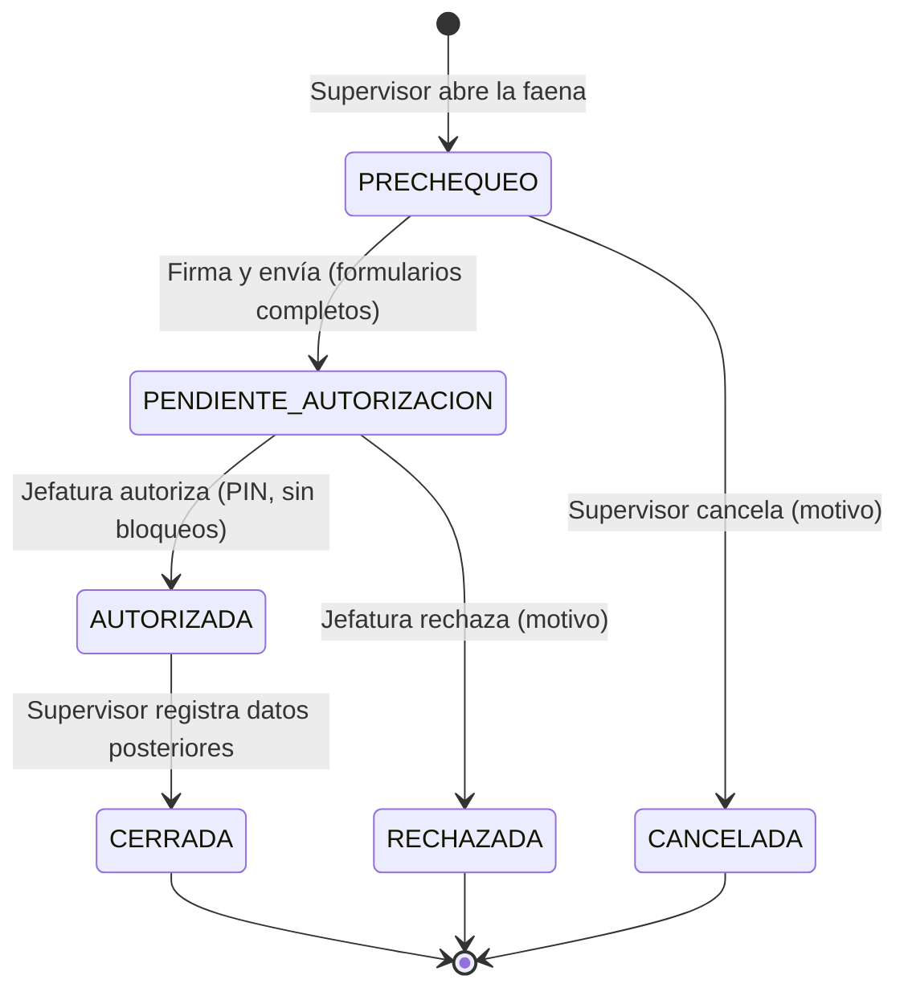
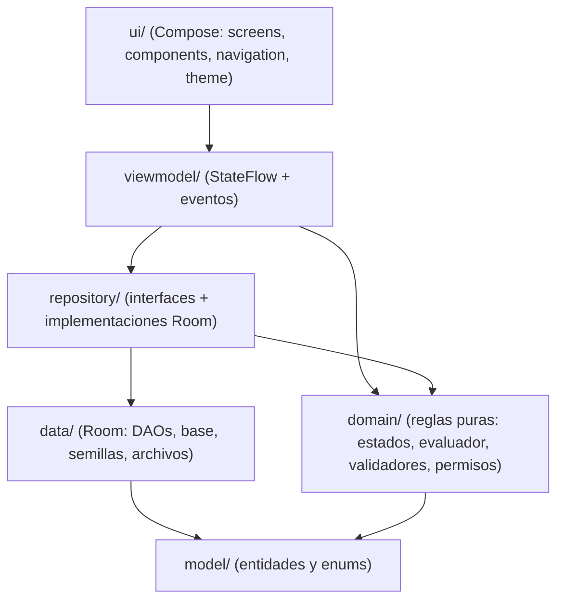

# AquaFlow - Control de Pre-Chequeo para Faenas de Buceo

Aplicación Android (Kotlin + Jetpack Compose) para AquaChile que digitaliza el pre-chequeo de seguridad de las faenas de buceo: apertura de faena, checklist de equipos DPR-24 con evidencias fotográficas, AST, encuesta de salud, autorización o rechazo por la jefatura, registro posterior e historial. Funciona **100 % local** (Room/SQLite), pensada para trabajar sin conexión en el pontón.

> **Estado de verificación.** Esta versión fue implementada en un entorno sin acceso a Internet, por lo que **no pudo compilarse ni ejecutarse allí**. Se verificó de forma estática (imports, firmas, coherencia entre capas) y se escribieron los tests, pero el primer `Sync` y `assembleDebug` en Android Studio es la verificación real. Ver [Primeros pasos](#primeros-pasos).

## Funcionalidades (MVP)

| Módulo | Qué hace |
|--------|----------|
| **Acceso por rol** | Login con RUT + PIN de 4 dígitos y selección de rol (Supervisor de Buceo / Jefe de Centro-Prevención). Sesión persistente, bloqueo temporal tras 5 intentos fallidos. |
| **Dashboard** | Supervisor: faenas en curso y acceso rápido a nueva faena. Jefatura: faenas pendientes de autorización. Resumen por estado, última faena e indicador de registros sin sincronizar. |
| **Apertura de faena** | Centro de cultivo, fecha/hora y buzo (con vigencia de certificación). Genera el código `F-AAAA-NNNN`. |
| **Checklist DPR-24** | 4 equipos críticos: Cumple / No cumple / Observado, nota obligatoria en fallas y evidencias fotográficas (cámara o galería) por equipo y generales. |
| **AST** | Antecedentes, gating de seguridad previo (toda condición "NO" suspende la inmersión), riesgos críticos y verificación de medidas de control. |
| **Encuesta de salud** | Signos vitales (presión, SpO2, temperatura) y declaración DS 752. |
| **Resumen y decisión** | Auditoría consolidada, firma del supervisor con PIN, autorización (con PIN) o rechazo con motivo por la jefatura. |
| **Registro posterior** | Tiempo de fondo, profundidad máxima, presión del banco y chequeo médico de salida; cierra la faena. |
| **Historial** | Datos reales de la base local con búsqueda por texto y filtros por estado y fecha. |
| **Usuarios** (jefatura) | Alta de usuarios con RUT validado y PIN, activación y desactivación. |

### Ciclo de vida de una faena



Las transiciones se validan en `FaenaStateMachine` y se vuelven a comprobar en el repositorio: la interfaz no puede forzar un salto de estado. **Autorizar** exige formularios completos y ninguna condición de seguridad incumplida (equipo "No cumple", gating AST con "NO", declaración de salud desfavorable). Rechazar siempre es posible con motivo.

### Permisos

| Acción | Supervisor (responsable) | Otro supervisor | Jefatura |
|--------|:-:|:-:|:-:|
| Abrir faena | ✔ | ✔ (las suyas) | ✘ |
| Ver faena | ✔ | ✘ | ✔ (todas) |
| Editar formularios / evidencias / firmar / cancelar (solo en pre-chequeo) | ✔ | ✘ | ✘ |
| Autorizar / rechazar (solo pendiente) | ✘ | ✘ | ✔ |
| Registro posterior (solo autorizada) | ✔ | ✘ | ✘ |
| Gestionar usuarios | ✘ | ✘ | ✔ |

Se aplican en tres capas: navegación (`AppNavHost` + `AccessPolicy.puedeAccederA`), ViewModels (modo lectura/edición) y repositorios (rechazan la operación aunque la UI la permita). Sin sesión, el grafo de navegación autenticado no existe.

## Primeros pasos

Requisitos: **Android Studio** reciente (Ladybug o superior), **JDK 17+** (el JBR incluido sirve), Android SDK 36.

1. Abrir la carpeta del proyecto en Android Studio y esperar el *Gradle Sync* (necesita Internet la primera vez).
2. Ejecutar en un emulador/dispositivo (API 26 o superior) con la configuración `app`.
3. Tests y verificación desde la terminal:

```bash
./gradlew assembleDebug            # compila
./gradlew testDebugUnitTest        # tests unitarios (JVM)
./gradlew lintDebug                # análisis estático
./gradlew connectedDebugAndroidTest  # tests con Room real (requiere emulador/dispositivo)
```

### Usuarios de demostración (datos ficticios)

| Rol | RUT | PIN |
|-----|-----|-----|
| Supervisor de Buceo | 15.892.403-K | 4921 |
| Supervisor de Buceo | 14.785.236-3 | 1357 |
| Jefe de Centro / Prevención | 12.433.910-3 | 2468 |

En builds *debug* la pantalla de login también los muestra. Hay un buzo con la certificación vencida a propósito para probar la regla de asignación.

### Flujo de prueba sugerido

1. Entrar como supervisor (4921) → **Nueva faena** → elegir centro y buzo.
2. Completar **DPR-24**, **AST** y **Encuesta de salud**; **Guardar** cada una (agregar alguna foto).
3. **Resumen y decisión** → *Firmar y enviar a revisión* (PIN).
4. Cerrar sesión, entrar como jefatura (2468) → abrir la faena pendiente → *Autorizar* (PIN).
5. Volver al supervisor → **Registro posterior** → cerrar la faena → revisar el **Historial**.
6. Repetir marcando un equipo "No cumple": la autorización queda bloqueada y solo se puede rechazar.

## Arquitectura

MVVM con flujo de datos unidireccional, un solo módulo `:app` y **sin framework de inyección** (un `AppContainer` manual entrega las dependencias por constructor).



```
app/src/main/java/com/duoc/aquaflow/
├── AquaFlowApplication.kt, MainActivity.kt
├── di/AppContainer.kt             # dependencias manuales
├── model/                         # entidades Room, enums, proyecciones (FaenaDetalle, SessionState)
├── domain/
│   ├── AppResult.kt, Fechas.kt
│   ├── catalog/Catalogos.kt       # equipos DPR-24, gating AST, riesgos, declaración de salud
│   ├── config/ReglasConfig.kt     # valores configurables (incluye los PROVISIONALES)
│   └── rules/                     # FaenaStateMachine, FaenaEvaluator, Validadores, AccessPolicy, Rut, PinHasher, FaenaFiltro
├── data/
│   ├── local/                     # AquaFlowDatabase, dao/, SharedPrefsSessionStore
│   ├── seed/DatabaseSeeder.kt     # datos ficticios iniciales
│   └── files/EvidenciaStorage.kt  # fotos en almacenamiento interno
├── repository/                    # Auth, Usuario, Catalogo, Faena (+ SyncGateway)
├── viewmodel/                     # un ViewModel por pantalla
└── ui/{theme,components,navigation,screens}
```

### Decisiones técnicas

- **Room como fuente de verdad** y persistencia 100 % local. Cada faena guarda una *foto* de los nombres de centro/buzo/supervisor para que el expediente histórico no cambie. Toda escritura relevante deja un evento en la bitácora (`EventoFaena`).
- **Reglas fuera de la UI**: `FaenaStateMachine`, `FaenaEvaluator`, `Validadores` y `AccessPolicy` son funciones puras y se prueban sin Android.
- **PIN** con sal aleatoria y PBKDF2-HMAC-SHA256 (nunca en claro). Firmas y autorizaciones piden el PIN y cuentan intentos fallidos.
- **Fotos** con el intent de cámara del sistema + `FileProvider` (sin permiso `CAMERA`) o galería; se copian a `filesDir/evidencias/<faena>/` y en la base solo se guarda la ruta relativa. `allowBackup=false` y reglas de extracción impiden que datos de salud salgan por backup.
- **Sin backend ficticio**: `SyncGateway` es el punto de extensión para una futura sincronización; hoy informa "sin servidor". El indicador de "sin sincronizar" es real (columna `estadoSync`).
- **minSdk 26** (en vez de 24) para usar `java.time` y PBKDF2-SHA256 sin desugaring.
- **Tipografía**: se usa la sans-serif del sistema porque Inter no puede descargarse sin red; ver `ui/theme/Type.kt` para activarla (agregar los `.ttf` a `res/font`).

## Valores provisionales y supuestos

Los documentos del proyecto no entregan criterios médicos ni operacionales oficiales, por lo que **no se inventaron**. Lo que sí se necesitó para que el MVP funcione está centralizado y marcado como provisional en `domain/config/ReglasConfig.kt` y `domain/catalog/Catalogos.kt`:

- Rangos de referencia de signos vitales (solo generan **avisos**; no bloquean salvo que se active `bloquearAutorizacionPorSignos`).
- Límite de profundidad planificada (30 m, tomado de la maqueta AST).
- Riesgos críticos 2 y 3 y tipologías de tarea (la maqueta solo muestra el primer riesgo).
- La **jefatura autoriza** (el documento no es unívoco entre "administrador" y "supervisor").
- Un buzo con certificación vencida a la fecha de la faena no puede asignarse; un buzo no puede tener dos faenas activas.

Detalle en [`docs/diseno/supuestos-y-valores-provisionales.md`](docs/diseno/supuestos-y-valores-provisionales.md).

## Pruebas

- **Unitarias (JVM)** en `app/src/test`: RUT y PIN, máquina de estados, permisos, evaluador de reglas, validadores, filtros del historial, autenticación (incluido bloqueo por intentos) y ViewModels (login, checklist, decisión).
- **Instrumentadas** en `app/src/androidTest`: con una base Room real recorren el flujo completo, permisos, transiciones imposibles, evidencias y persistencia al cerrar y reabrir la base.

## Limitaciones conocidas

- Sin sincronización con servidor (por alcance); los datos viven en el dispositivo.
- Textos en español dentro del código (sin `strings.xml` multilenguaje).
- No incluye telemetría de instrumentos, hash de firmas, RFID/NFC ni huella (aparecen en las maquetas pero están fuera del alcance del MVP).
- Los valores provisionales deben validarse con AquaChile antes de uso real.

## Identidad visual

| Elemento | Valor | Uso |
|----------|-------|-----|
| Color principal | `#F95716` | Llamadas a la acción e iconografía |
| Color secundario | `#0B1723` | Encabezados, contenedores y contraste |
| Fondo | `#FFFFFF` / `#F4F6F8` | Lectura bajo luz solar |
| Tipografía | Inter Bold (objetivo) | Ver nota de tipografía |

Maquetas de referencia en [`docs/diseno/interfaces/`](docs/diseno/interfaces).

## Documentación

| Documento | Descripción |
|-----------|-------------|
| `docs/evidencias/clase-01/Evidencia_Clase_01_MVP_Equipo_Codigines.docx` | Definición del MVP |
| `docs/evidencias/clase-01/Actividad_Clase_2_Flujo_UML_Diseno_Interfaces.docx` | Flujo, UML y diseño de interfaces |
| `docs/diseno/interfaces/` | Maquetas extraídas del documento de Clase 2 |
| `docs/diseno/supuestos-y-valores-provisionales.md` | Decisiones de dominio a validar con el cliente |

## Equipo de desarrollo ("Los Codigines")

| Nombre | Rol |
|--------|-----|
| Alan Vidal | Líder Scrum |
| Álvaro Morales | Backend |
| Isidora Diaz | Backend |
| Francisco Molina | Frontend |

---

*Documentación generada en base a la definición de requerimientos del cliente AquaChile y arquitectura de diseño UI/UX. Última actualización: Octubre 2026.*
